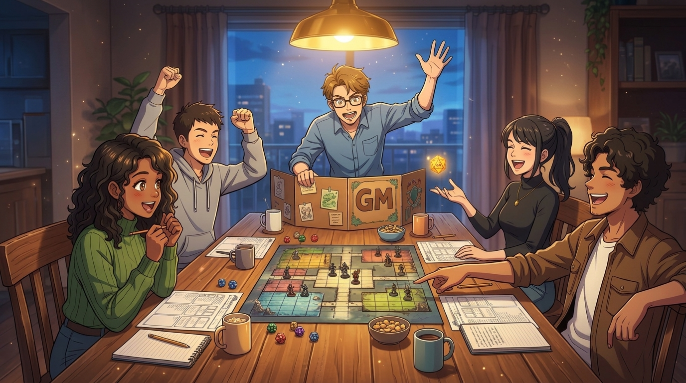

# Supa RPG Characters

Skill para **Antigravity** e agentes compatíveis que transforma listas de prompts, roteiros ou cenas de RPG em ilustrações visualmente consistentes dentro de `Output/`, vinculando cada personagem às suas imagens de referência em `Personagens/`.

## O que ela faz


1. **Cataloga referências (`Personagens/`):** lê imagens na raiz (agrupando variações como `Kael_01.png` e `Kael_02.png`) ou organizadas em subpastas por personagem (`Personagens/Kael/*.png`).
2. **Mapeia cenas e pesquisa lore:** identifica os personagens em cada prompt (inclusive suportando pares PT-BR + EN) e, quando falta referência de algum personagem de cenário conhecido (como *Tormenta* ou *D&D*), pesquisa traços canônicos para guiar a geração.
3. **Plano obrigatório antes de gerar:** apresenta uma tabela completa de associação (`Output/`, personagens, referências, proporção e continuidade numérica caso `Output/` já tenha arquivos) e aguarda sua aprovação explícita.
4. **Ancoragem anti-mistura e lotes paralelos:** lê cada referência uma única vez, separa **identidade imutável** de **variações da cena** (figurino, expressão, luz) para evitar *identity bleeding* entre múltiplos personagens e dispara lotes controlados no `image-generator`.
5. **Normalização e auditoria:** copia os arquivos gerados para `Output/` preservando a extensão real e verifica todos os arquivos entregues.

## Na mesa de RPG



### Como usar a skill passo a passo

1. **Organize as imagens de referência em `Personagens/`:**
   Coloque as artes dos seus personagens (`.png`, `.jpg`, `.jpeg` ou `.webp`) na pasta `Personagens/` na raiz do seu projeto — seja em arquivos diretos (`Komira.png`, `Brokk_01.png`, `Brokk_02.png`) ou em subpastas por personagem (`Personagens/Valtharion/frente.png`).
2. **Envie seu roteiro ou lista de cenas no chat:**
   Invoque `/supa-rpg-characters` colando os prompts diretamente na conversa ou informando o caminho de um arquivo `.txt` ou `.md` com as cenas da sessão (inclusive com versões em português e inglês).
   ```text
   /supa-rpg-characters Gere as ilustrações das cenas em ./roteiro-sessao.md no estilo anime cinematic (16:9)
   ```
3. **Revise e aprove o plano de geração:**
   Antes de gerar qualquer imagem, a skill monta uma tabela ligando cada cena aos personagens encontrados, às referências em `Personagens/` e aos arquivos numerados que serão criados em `Output/`. Aprove o plano ou peça ajustes de proporção (`16:9`, `3:4`, `1:1`), estilo, idioma-base ou referências.
4. **Receba as ilustrações em `Output/` e refine se precisar:**
   Com o plano aprovado, as cenas são geradas em lotes paralelos preservando a identidade visual de cada personagem e salvas em `Output/`. Quer mudar algum detalhe? Basta pedir pelo número da cena (ex.: *"Refaça a cena 03 deixando a iluminação mais escura"*).

## Estrutura esperada no seu projeto de RPG

```text
meu-projeto-rpg/
├── Personagens/
│   ├── Komira.png
│   ├── Brokk.png
│   └── Valtharion/
│       ├── frente.png
│       └── manto.png
└── Output/
    ├── 01_primeira_cena.jpg
    └── 02_segunda_cena.jpg
```

## Instalação / Vínculo

### Global no Antigravity (Windows — NTFS Junction recomendada)
```powershell
New-Item -ItemType Junction `
  -Path "$env:USERPROFILE\.gemini\config\skills\supa-rpg-characters" `
  -Target "C:\Users\ajtop\OneDrive\Documents\CODE\supa-rpg-characters"
```

### Por projeto
Copie ou vincule esta pasta em `.agents/skills/supa-rpg-characters` dentro do workspace desejado e invoque `/supa-rpg-characters` no chat.

## Licença

[MIT](./LICENSE)
