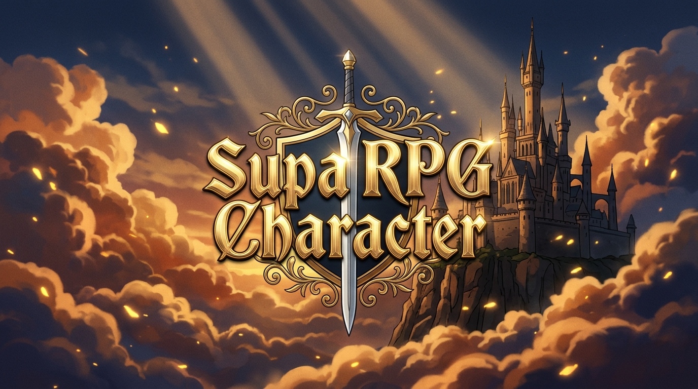
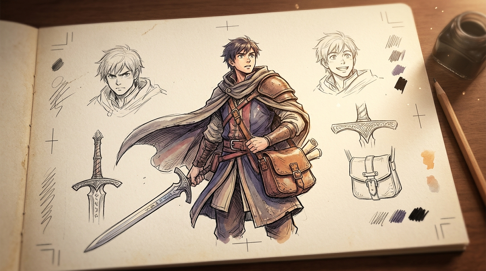

# Supa RPG Characters

Skill para **Antigravity** e agentes compatíveis que transforma listas de prompts, roteiros ou cenas de RPG em ilustrações visualmente consistentes dentro de `Output/`, vinculando cada personagem às suas imagens de referência em `Personagens/`.

## O que ela faz



1. **Cataloga referências (`Personagens/`):** lê imagens na raiz (agrupando variações como `Kael_01.png` e `Kael_02.png`) ou organizadas em subpastas por personagem (`Personagens/Kael/*.png`).
2. **Mapeia cenas e pesquisa lore:** identifica os personagens em cada prompt (inclusive suportando pares PT-BR + EN) e, quando falta referência de algum personagem de cenário conhecido (como *Tormenta* ou *D&D*), pesquisa traços canônicos para guiar a geração.
3. **Plano obrigatório antes de gerar:** apresenta uma tabela completa de associação (`Output/`, personagens, referências, proporção e continuidade numérica caso `Output/` já tenha arquivos) e aguarda sua aprovação explícita.
4. **Ancoragem anti-mistura e lotes paralelos:** lê cada referência uma única vez, separa **identidade imutável** de **variações da cena** (figurino, expressão, luz) para evitar *identity bleeding* entre múltiplos personagens e dispara lotes controlados no `image-generator`.
5. **Normalização e auditoria:** copia os arquivos gerados para `Output/` preservando a extensão real e verifica todos os arquivos entregues.

## Na mesa de RPG


## Estrutura esperada no seu projeto de RPG

```text
meu-projeto-rpg/
├── Personagens/
│   ├── Komira.png
│   ├── Brokk.png
│   └── Valtharion/
│       ├── frente.png
│       └── manto.png
└── Output/
    ├── 01_primeira_cena.jpg
    └── 02_segunda_cena.jpg
```

## Instalação / Vínculo

### Global no Antigravity (Windows — NTFS Junction recomendada)
```powershell
New-Item -ItemType Junction `
  -Path "$env:USERPROFILE\.gemini\config\skills\supa-rpg-characters" `
  -Target "C:\Users\ajtop\OneDrive\Documents\CODE\supa-rpg-characters"
```

### Por projeto
Copie ou vincule esta pasta em `.agents/skills/supa-rpg-characters` dentro do workspace desejado e invoque `/supa-rpg-characters` no chat.

## Licença

[MIT](./LICENSE)
